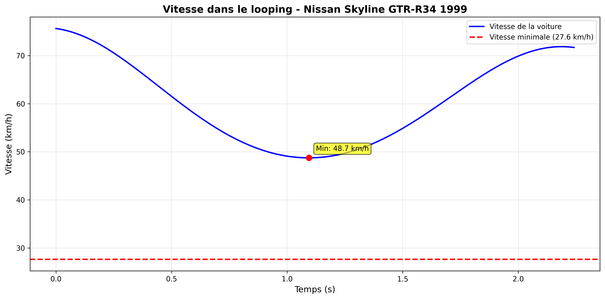
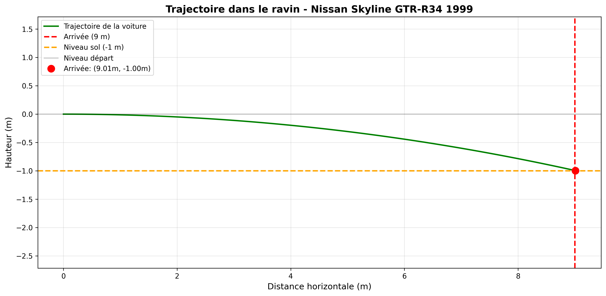

# Simulation numérique d'un circuit : pente, looping et saut de ravin

Projet de mécanique de groupe réalisé au **CESI** (cycle préparatoire ingénieur, 1ère année, 2025). Nous avons modélisé le mouvement d'une voiture sur un circuit, simulé 6 modèles de voiture en **Python** (méthode d'Euler), puis comparé le modèle à des mesures réelles avec un calcul d'incertitudes.

## Contexte

Le circuit est inspiré de *Fast & Furious*. Il faut battre le temps d'Owen Shaw, annoncé à moins de 8 secondes.

| Portion | Caractéristiques |
|---|---|
| Piste d'élan (pente) | 2 m de hauteur, 31 m de longueur |
| Looping | 6 m de rayon |
| Saut de ravin | 9 m de large, 1 m de dénivelé négatif |
| Fin de piste | 10 m de piste horizontale |

## Démarche

**1. Modélisation**
- La voiture est étudiée dans un référentiel terrestre supposé galiléen.
- Forces prises en compte : poids, réaction du sol, force motrice, frottement de l'air et frottement des roues sur le sol.
- Équations établies avec la 2e loi de Newton, en repère de Frenet pour le looping et avec traînée et portance pour le saut.

**2. Simulation (`code/simulation_circuit.py`)**
- Un simulateur interactif : on choisit une voiture parmi 6 modèles et des accessoires (booster, ailerons, jupe avant).
- Chaque portion est résolue par la méthode d'Euler : vitesse en bas de la pente, vitesse dans le looping avec vérification qu'elle reste suffisante au sommet, trajectoire du saut, puis temps de la fin de piste.
- Le programme affiche le temps total, le compare aux 8 secondes d'Owen Shaw, puis enregistre les courbes et les données.

**3. Comparaison avec la réalité**
- 50 essais de mesure de vitesse par voiture, en fin de pente et en fin de looping.
- Incertitude de répétabilité (écart type des essais), incertitude de résolution du télémètre (5 km/h, soit 1,39 m/s, valeur retenue par le groupe), incertitude composée, puis incertitude élargie (k = 2, environ 95 % de confiance).
- Comparaison des vitesses simulées aux vitesses mesurées pour chaque voiture.

## Résultats (simulation sans accessoire)

| Voiture | Vitesse fin de pente (m/s) | Passe le looping ? |
|---|---|---|
| 1. Dodge Charger R/T 1970 | 17,08 | Non |
| 2. Toyota Supra Mark IV 1994 | 16,92 | Non |
| 3. Chevrolet Yenko Camaro 1969 | 17,43 | Non |
| 4. Mazda RX-7 FD | 17,28 | Non |
| 5. Nissan Skyline GTR-R34 1999 | 18,29 | **Oui** |
| 6. Mitsubishi Lancer Evolution VII | 16,91 | Non |

Sans accessoire, aucune voiture ne réalise le circuit complet : la Nissan passe le looping (sortie à 17,45 m/s), mais n'atteint pas la vitesse minimale pour franchir le ravin (environ 19,9 m/s).

## Choix de la voiture

La **Nissan Skyline GTR-R34** est la seule voiture à réaliser le circuit complet, avec un booster :

| Booster utilisé sur | Temps total simulé |
|---|---|
| La pente | **6,11 s** |
| Le looping | 6,70 s |

Les deux temps sont inférieurs aux 8 secondes d'Owen Shaw. Son accélération de 5,8 m/s² et sa masse modérée lui donnent les vitesses nécessaires sur toutes les portions.

### Graphiques (Nissan Skyline, booster sur la pente)

**Vitesse dans le looping**



**Trajectoire dans le ravin**



## Lancer le code

```bash
pip install numpy matplotlib
python code/simulation_circuit.py
```

Le programme demande de choisir la voiture (1 à 6), puis les accessoires. Il enregistre les graphiques au format PNG et les données de vitesse et de trajectoire en `.txt` dans le dossier courant.

## Limites du modèle

- La voiture est assimilée à un point matériel, avec des coefficients (frottement du sol, traînée, portance) supposés constants.
- Dans le looping, seule l'accélération du booster est appliquée, et pas l'accélération moteur de base.
- Le booster est modélisé différemment selon la portion (+30 % de l'accélération sur la pente et la fin de piste, +30 % ajoutés dans le looping), ce qui rend les temps selon la portion difficiles à comparer.
- La méthode d'Euler est simple, mais son erreur dépend du pas de temps choisi (0,001 s ici).

## Compétences mobilisées

Modélisation physique · équations différentielles · méthode d'Euler · Python (NumPy, Matplotlib) · programmation orientée objet · analyse d'incertitudes · esprit critique sur les résultats

## Auteur

**Ilyass AIT ALI** · étudiant ingénieur informatique au CESI
[Portfolio](https://ilyassa1.github.io) · [LinkedIn](https://www.linkedin.com/in/ilyass-ait-ali/)

*Projet pédagogique réalisé en groupe dans le cadre de la formation CESI.*

<!--
OPTIONNEL : pour ajouter ta contribution, décommente et complète cette section.

## Ma contribution
- (par exemple : j'ai écrit le code Python / les équations du looping / les calculs d'incertitudes)
-->
